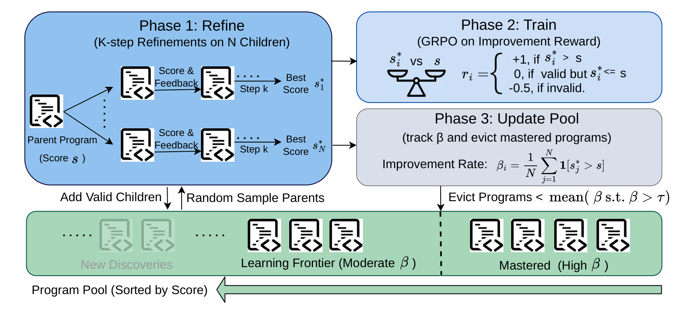
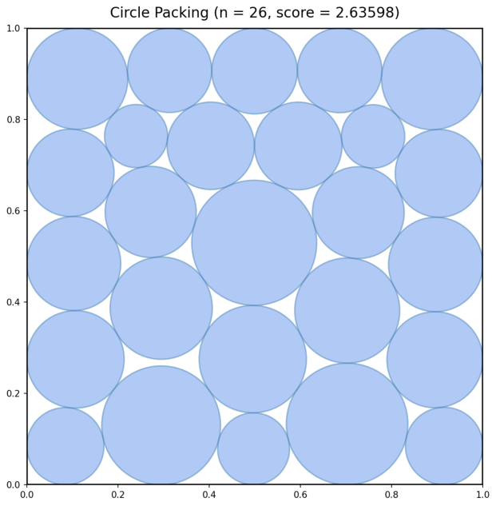

<div align="center">

# KTPO: K-Step Test-Time Policy Optimization for Long-Horizon Discovery

Dacheng Li<sup>†</sup>, Fangzhou Zhao<sup>†</sup>, Shiyi Cao<sup>†</sup>, Hao Zhang<sup>‡</sup>, Joseph E. Gonzalez<sup>†</sup>, Ion Stoica<sup>†</sup>

<sup>†</sup>UC Berkeley (Sky Computing Lab) · <sup>‡</sup>UC San Diego

<br>

**COLM 2026** · [Paper (OpenReview)](https://openreview.net/forum?id=t2MIMXJq3W)

</div>

## TL;DR

- Optimizing real systems — SQL prefix caching, multi-cloud transfer, MoE load balancing, model placement, transaction scheduling — is a **long-horizon discovery problem**: good solutions take hundreds of rounds of refinement.
- KTPO adapts a **small open model (4B–9B)** at test time. Each iteration: **Refine** (k-step refinements from programs in a pool), **Train** (GRPO with an improvement reward), **Update pool** (evict programs by improvement rate).
- On these systems tasks it is **competitive with search methods using GPT-5 and Gemini-3-Pro**: **$626.9** on multi-cloud transfer (human $626.2), **0.14638** on MoE load balancing (above the prior published 0.1453), and **0.738** SQL prefix hit rate (human 0.692).

## Problem

Optimizing real systems, like solving open math problems, is a long-horizon discovery problem: good solutions are found over hundreds of rounds of refinement, each checked by an evaluator. LLMs are emerging as a promising approach for such discovery problems, but existing search methods keep the LLM frozen across hundreds of refinement steps, and applying RL over full search trajectories of hundreds of refinement steps remains difficult.

**Our approach:** train with RL on short k-step refinements, each starting from a program the model already found — training stays short while the search stays long.

## Method

We treat each task as program search: given an initial program, iteratively produce improved programs scored by a deterministic evaluator. KTPO trains the LLM on short trajectories of k refinement steps. To retain the benefits of longer search, each trajectory starts from a previously discovered program rather than from scratch. KTPO selects programs near the model's current capability frontier, estimated by the model's improvement rate over existing programs.

<p align="center"></p>

Three phases per iteration:

1. **Refine**: sample parent programs from the pool and, for each parent, generate a group of k-step refinement trajectories. Each step sees the previous program and its evaluator feedback.
2. **Train**: update the policy with GRPO using the improvement reward: `+1` if the best of the k steps beats the parent, `0` if the trajectory is valid but does not improve, and `-1/2` only when all k steps are invalid.
3. **Update pool**: add valid programs to the pool and apply improvement-rate eviction. A parent's improvement rate is the fraction of its trajectories whose best step beats it. Parents at or above a threshold (decaying linearly from 0.30 to 0.00) count as mastered, and programs scoring below the mean of the last 10 mastered parents are evicted (the best program is always kept).

All paper runs use k = 8, 16 parents × 16 trajectories per iteration, 50 iterations, temperature 1.0 and a 32,768-token response limit.

## Results

### Systems optimization (ADRS)

| | LLM-SQL ↑ | Cloudcast ($) ↓ | EPLB ↑ | Prism ↑ | TXN ↑ |
|---|---|---|---|---|---|
| Human / SOTA | 0.692 | **626.2** | 0.1265 | 21.89 | 2725 |
| Best published AI\* | **.775** | 637.1 | .1453 | **26.37** | **4348** |
| KTPO, Qwen3-4B | .738 | 651.3 | — | — | — |
| KTPO, Qwen3.5-9B | .737 | 626.9 | **.14638** | 26.256 | 4149 |

\*Best per task over OpenEvolve, GEPA, ShinkaEvolve and AdaEvolve with GPT-5 or Gemini-3-Pro (their published results). KTPO: best score across seeds (Qwen3-4B: 3 seeds; Qwen3.5-9B: 1 seed). **Bold**: best per column.

- **Multi-cloud transfer:** $626.9, within $0.7 of the human record ($626.2).
- **Expert-parallel load balancing:** 0.14638, above the prior published 0.1453.
- **SQL prefix hit rate:** 0.738 with a 4B model, above the human baseline (0.692).

### Math problems

<table><tr><td>

| | Circle Packing ↑ | Erdős ↓ |
|---|---|---|
| Human | 2.634 | 0.380927 |
| Best known | 2.63598 | 0.380876 |
| KTPO, Qwen3-4B | 2.63579 | 0.380938 |
| KTPO, Qwen3.5-9B | 2.63598 | 0.380950 |

</td><td></td></tr></table>

Best known: Circle Packing 2.63598 (ShinkaEvolve, ThetaEvolve); Erdős 0.380876 (TTT-Discover, gpt-oss-120B). Right: the best n = 26 packing KTPO found (Σr = 2.63598).

### What makes it work (Circle Packing, Qwen3-4B)

- **Eviction, the pool, and multistep revision each matter.** At 102k evaluations: KTPO 2.635 ± 0.0004; no eviction 2.616 ± 0.008; no pool 2.624 ± 0.004. Revision depth at 51k matched compute: k = 4 reaches 2.635 ± 0.001, k = 1 reaches 2.613 ± 0.017.
- **Why the pool needs eviction.** Without eviction the pool grows to ~60k programs; with eviction it stays at ~1.3k, and the average best-of-k rises to ~2.0 while no eviction stays near 1.0.
- **Training cost.** At a matched budget of 51.2k programs, the GRPO update is 14% of training time, and KTPO costs 1.14× (update only) to 1.86× (end to end) the wall-clock of inference-only search. Training keeps improving while search alone stays flat at ~0.5:

| Avg. output score | 1 h | 2 h | 3 h | 5 h | 7 h | 10 h | 16 h | 20 h |
|---|---|---|---|---|---|---|---|---|
| KTPO | 0.54 | 1.03 | 1.40 | 1.81 | 1.92 | 2.10 | 2.32 | 2.33 |
| Inference-only | 0.51 | 0.46 | 0.43 | 0.56 | 0.58 | 0.56 | 0.59 | 0.56 |

## Tasks

The systems tasks come from ADRS ([Cheng et al., 2025](https://arxiv.org/abs/2510.06189)). Each is taken from prior systems work: papers at MLSys, NSDI and VLDB, a multi-LLM serving system, and DeepSeek's expert load balancer. All tasks live in `openevolve_adapted/examples/<task>/` (initial program, evaluator, config).

| Task | Directory | What is optimized | Origin |
|---|---|---|---|
| LLM-SQL ↑ | `llm_sql` | Column order of a table fed to an LLM row by row, to maximize the prefix-cache hit rate across real datasets | [Liu et al., MLSys 2025](https://arxiv.org/abs/2403.05821) |
| Cloudcast ($) ↓ | `cloudcast` | Broadcast a dataset from one cloud region to many destinations over uneven egress prices and bandwidth, at minimum cost | [Wooders et al., NSDI 2024](https://www.usenix.org/conference/nsdi24/presentation/wooders) |
| EPLB ↑ | `eplb` | Replicate and place MoE experts across GPUs to balance load, with a fast rebalancing algorithm | [DeepSeek EPLB](https://github.com/deepseek-ai/EPLB) |
| Prism ↑ | `prism` | Place several LLMs on a fixed GPU cluster (80 GB per GPU) to minimize the worst KV-cache pressure | [Yu et al., 2025](https://arxiv.org/abs/2505.04021) |
| TXN ↑ | `txn_scheduling` | Order database transactions with read/write conflicts to minimize total makespan | [Cheng et al., VLDB 2024](https://www.vldb.org/pvldb/vol17/p2694-cheng.pdf) |
| Circle Packing ↑ | `circle_packing_modular` | Place 26 non-overlapping circles in a unit square to maximize the sum of radii | |
| Erdős minimum overlap ↓ | `erdos_min_overlap` | Construct a function that gives a better upper bound on the overlap constant | |

Initial programs are each benchmark's standard one, untuned.

## Requirements

- One node with 8x H100 (80 GB). Training and rollout are colocated on the same 8 GPUs.
- Docker with the NVIDIA runtime. The slime images provide Megatron-LM, SGLang and PyTorch.
- Python dependencies from `requirements.txt` (includes `cvxpy`) and `openevolve_adapted` (pins `numpy<2`, which the 4B path needs).
- EPLB needs a workload file before launch:

```bash
wget -O openevolve_adapted/examples/eplb/evaluators/expert-load.json \
  https://huggingface.co/datasets/abmfy/eplb-openevolve/resolve/main/expert-load.json
```

Common environment variables:

```bash
export SAVE_PATH=/path/to/ckpts       # model copies, checkpoints, records
# Optional: W&B logging is enabled only when WANDB_API_KEY is set.
export WANDB_API_KEY=...  WANDB_ENTITY=...  WANDB_PROJECT=KTPO
```

## Run: Qwen3-4B-Instruct-2507

Scripts: `scripts_launch/Qwen3-4B-Instruct-2507/ktpo_4b_16x16x8_{circle_packing,erdos,llm_sql,cloudcast}.sh`.

```bash
docker run --rm -it --gpus all --ipc=host --shm-size=16g \
  --ulimit memlock=-1 --ulimit stack=67108864 \
  -v "$PWD":/workspace -w /workspace \
  -v "$SAVE_PATH":/ckpts -e SAVE_PATH=/ckpts \
  -e WANDB_API_KEY -e WANDB_ENTITY -e WANDB_PROJECT \
  slimerl/slime:v0.5.0rc0-cu126 /bin/bash

# inside the container
pip install -e .
pip install --ignore-installed blinker
pip install -e openevolve_adapted        # also installs numpy<2
SEED=1 bash scripts_launch/Qwen3-4B-Instruct-2507/ktpo_4b_16x16x8_circle_packing.sh
```

## Run: Qwen3.5-9B

The 9B path needs Megatron-LM and SGLang patches for Qwen3.5. `docker/launchers/launch.sh` pulls a pinned slime image, mounts the repo and `CKPTS_DIR`, forwards `LEARNX_*`, `WANDB_*`, `HF_*` and `OPENAI_*` variables, applies the patches, installs this repo and runs the task script from `scripts_launch/Qwen3.5-9B/`.

```bash
export CKPTS_DIR=/path/to/ckpts
SEED=1 bash docker/launchers/launch.sh run_circle_packing.sh
SEED=1 bash docker/launchers/launch.sh run_erdos.sh
SEED=1 bash docker/launchers/launch.sh run_llm_sql.sh
SEED=1 bash docker/launchers/launch.sh run_cloudcast.sh
SEED=1 bash docker/launchers/launch.sh run_adrs.sh eplb    # or: prism, txn
```

## Smoke test

Any launcher accepts environment overrides. A short run with one iteration and a small batch:

```bash
LEARNX_NUM_ROLLOUT=1 LEARNX_ROLLOUT_BATCH_SIZE=2 LEARNX_OVER_SAMPLING_BATCH_SIZE=2 \
LEARNX_N_SAMPLES_PER_PROMPT=4 LEARNX_MULTISTEP_K=2 \
SEED=1 bash scripts_launch/Qwen3-4B-Instruct-2507/ktpo_4b_16x16x8_circle_packing.sh
```

Environment variables keep the historical `LEARNX_` prefix (for example `LEARNX_MULTISTEP_K`, `LEARNX_NUM_ROLLOUT`, `LEARNX_ACDS_RETIRE_THR`); see the task scripts for the full list and the paper values.

## Verify a program

Evaluate a program with a task's evaluator on CPU (no GPU needed):

```bash
TASK=circle_packing_modular   # any task directory above
OPENEVOLVE_CONFIG_PATH=$PWD/openevolve_adapted/examples/$TASK/configs/config_$TASK.yaml \
PYTHONPATH=$PWD/openevolve_adapted:$PWD/openevolve_adapted/examples/$TASK/evaluators \
python -c "import sys, evaluator_modular as e; print(e.evaluate(sys.argv[1]).metrics)" \
  $PWD/openevolve_adapted/examples/$TASK/initial_programs/initial_program.py
```

The program path must be absolute. EPLB also needs `torch` and the workload file above.

## Acknowledgements

This work was done at the Sky Computing Lab at UC Berkeley. We sincerely thank Yiping Wang for helpful discussions, deep understanding of ThetaEvolve, and constructive design feedback. Our code is built on [ThetaEvolve](https://github.com/ypwang61/ThetaEvolve), which builds on [slime](https://github.com/THUDM/slime) and [OpenEvolve](https://github.com/codelion/openevolve). We gratefully acknowledge compute support from Lambda, Amazon, Databricks, and Anyscale.

## Citation

```bibtex
@inproceedings{li2026ktpo,
  title={{KTPO}: K-Step Test-Time Policy Optimization for Long-Horizon Discovery},
  author={Li, Dacheng and Zhao, Fangzhou and Cao, Shiyi and Zhang, Hao and Gonzalez, Joseph E. and Stoica, Ion},
  booktitle={Conference on Language Modeling (COLM)},
  year={2026},
  url={https://openreview.net/forum?id=t2MIMXJq3W}
}
```

## License

Apache-2.0. See `LICENSE` and `NOTICE`.
